

  <picture>
    <source media="(max-width: 640px)" srcset="assets/phase2/hero-mobile.svg" />
    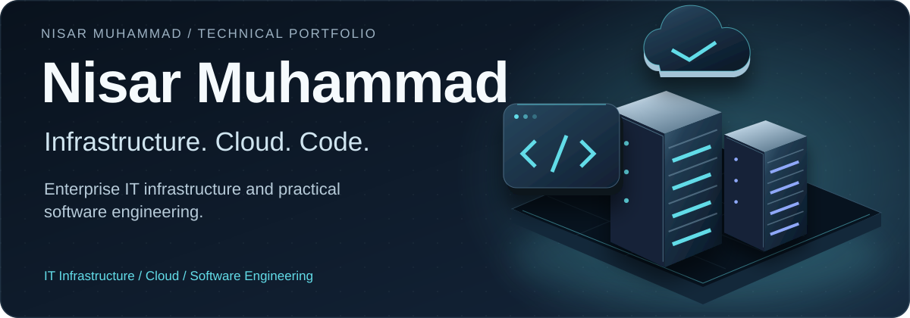
  </picture>

**Senior IT Infrastructure & Systems Administrator | Cloud & Microsoft 365 Engineer | Full-Stack Developer**

I bring **20+ years in IT**, including **13+ years supporting enterprise infrastructure in UAE higher education**. I connect infrastructure operations with practical software engineering to build secure, maintainable systems and business applications that improve everyday work.

Professional positioning reflecting experience and areas of practice.

##  About Me

<picture>
  <source media="(max-width: 640px)" srcset="assets/phase2/about-mobile.svg" />
  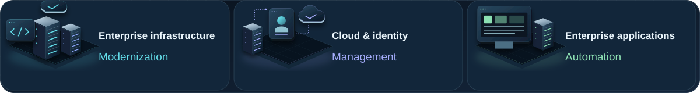
</picture>

- Modernize enterprise infrastructure across Windows Server, Active Directory, Hyper-V, networking, backup, and disaster recovery.
- Manage cloud and identity services with Microsoft Azure, Microsoft 365, and Entra ID, with a focus on security and dependable operations.
- Design practical enterprise applications and PowerShell automation, connecting infrastructure experience with maintainable software and more efficient workflows.

##  Technology Stack

<picture>
  <source media="(max-width: 640px)" srcset="assets/phase2/technology-mobile.svg" />
  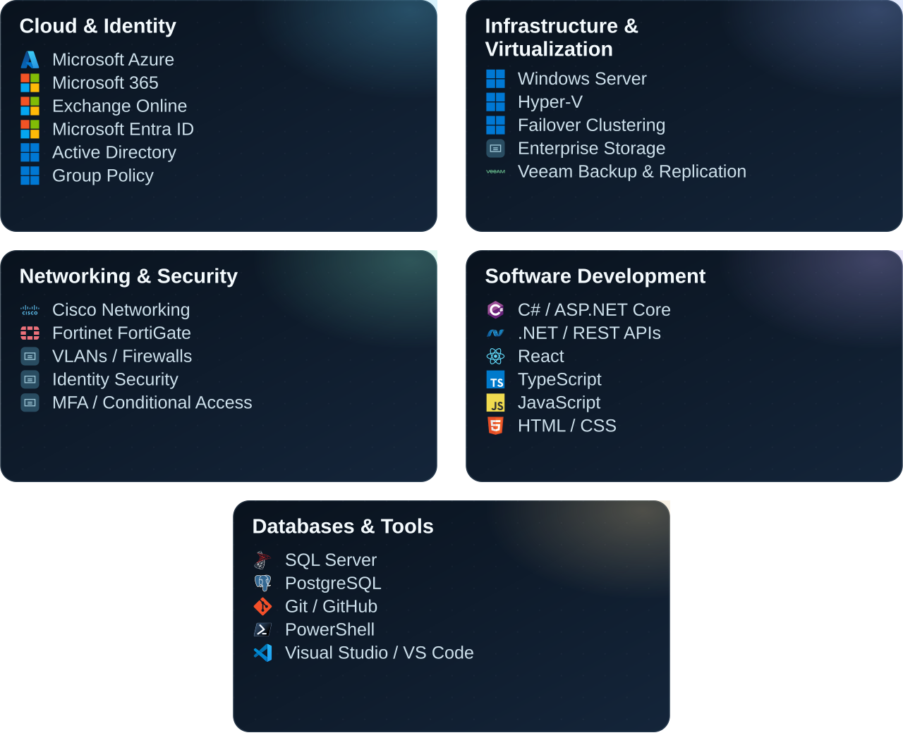
</picture>

Technology Stack — text reference

### Cloud & Identity

 

Exchange Online · Microsoft Entra ID · Active Directory · Group Policy

### Infrastructure & Virtualization

 

Failover Clustering · Enterprise Storage · Veeam Backup & Replication

### Networking & Security

 

VLANs · Firewalls · Identity Security · MFA · Conditional Access

### Software Development

 

C# · .NET · REST APIs · TypeScript · JavaScript · HTML · CSS

### Databases & Tools

 

SQL Server · Git · GitHub · Visual Studio · VS Code

##  Microsoft Certifications

<picture>
  <source media="(max-width: 640px)" srcset="assets/phase2/certifications-mobile.svg" />
  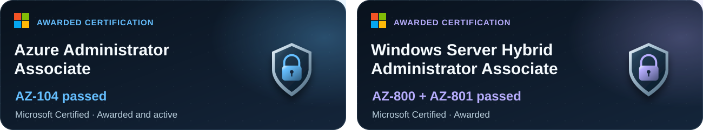
</picture>

<picture>
  <source media="(max-width: 640px)" srcset="assets/phase2/passed-exam-mobile.svg" />
  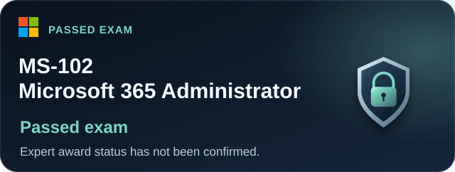
</picture>

Microsoft Certifications — text reference

**Awarded certifications**

| Certification | Exam record |
| :--- | :--- |
| **[Azure Administrator Associate](https://learn.microsoft.com/en-us/credentials/certifications/azure-administrator/)** Microsoft Certified · Awarded and active | AZ-104 passed |
| **Windows Server Hybrid Administrator Associate** Microsoft Certified · Awarded | AZ-800 + AZ-801 passed |

**Passed exam**

**MS-102 — Microsoft 365 Administrator** · Passed. The [Microsoft 365 Certified: Administrator Expert](https://learn.microsoft.com/en-us/credentials/certifications/m365-administrator-expert/) credential requires a qualifying prerequisite; its award status has not been confirmed.

<!-- Owner-confirmed certification and exam status. No credential IDs or verification links are published. Preserve the Windows Server credential title as awarded, even if the current Microsoft path is renamed. -->

**Continuing professional development:** Ongoing learning in hybrid cloud, identity security, infrastructure automation, and modern .NET and React application development.

##  Featured Projects

<a href="https://github.com/nisarnis-prog/Local-Admin-GPO-Deployment"><picture>
  <source media="(max-width: 640px)" srcset="assets/phase2/project-Local-Admin-GPO-Deployment-mobile.svg" />
  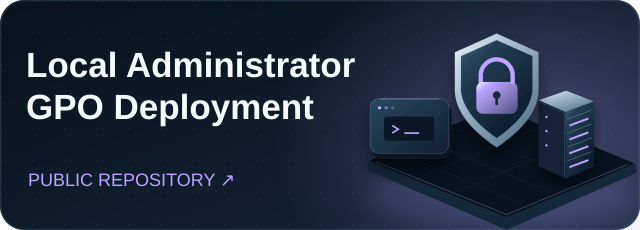
</picture></a> <a href="https://github.com/nisarnis-prog/Automatic-Printer-Deployment-GPO"><picture>
  <source media="(max-width: 640px)" srcset="assets/phase2/project-Automatic-Printer-Deployment-GPO-mobile.svg" />
  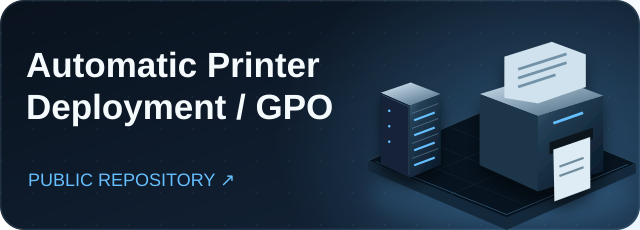
</picture></a>

<a href="https://github.com/nisarnis-prog/AD-M365-User-Onboarding-Toolkit"><picture>
  <source media="(max-width: 640px)" srcset="assets/phase2/project-AD-M365-User-Onboarding-Toolkit-mobile.svg" />
  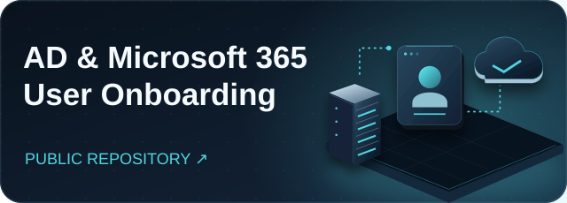
</picture></a> <a href="https://github.com/nisarnis-prog/Create-Cinematic-Reels-With-Codex"><picture>
  <source media="(max-width: 640px)" srcset="assets/phase2/project-Create-Cinematic-Reels-With-Codex-mobile.svg" />
  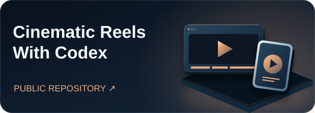
</picture></a>

<a href="https://github.com/nisarnis-prog/NTFS-Permission-Recovery-Toolkit"><picture>
  <source media="(max-width: 640px)" srcset="assets/phase2/project-NTFS-Permission-Recovery-Toolkit-mobile.svg" />
  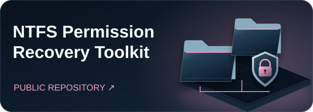
</picture></a> <a href="https://github.com/nisarnis-prog/Computer-Inventory-Automation-Toolkit"><picture>
  <source media="(max-width: 640px)" srcset="assets/phase2/project-Computer-Inventory-Automation-Toolkit-mobile.svg" />
  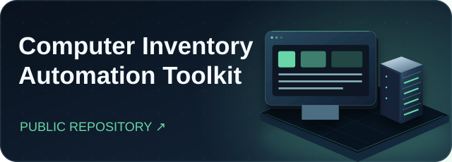
</picture></a>

<a href="https://github.com/nisarnis-prog/Free-Data-Recovery-Guides"><picture>
  <source media="(max-width: 640px)" srcset="assets/phase2/project-Free-Data-Recovery-Guides-mobile.svg" />
  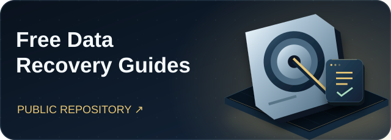
</picture></a> <a href="https://github.com/nisarnis-prog/youtube-mp3-downloader"><picture>
  <source media="(max-width: 640px)" srcset="assets/phase2/project-youtube-mp3-downloader-mobile.svg" />
  
</picture></a>

Featured Projects — detailed project notes

<table width="100%">
<tr><td>
<h3>01 — YouTube MP3 Downloader</h3>

<strong>Public project</strong> · Windows desktop C# · .NET · WPF · Chrome companion extension

Batch audio downloads with one queue, up to five concurrent downloads, and a built-in MP3 player.

<a href="https://github.com/nisarnis-prog/youtube-mp3-downloader"><strong>Explore the repository →</strong></a> · <a href="https://github.com/nisarnis-prog/youtube-mp3-downloader#application-screenshots">More screenshots</a>

</td></tr>
</table>

  

<table width="100%">
<tr><td>
<h3>02 — Enterprise IT Asset Management Platform</h3>

<strong>Private / internal case study</strong> · Asset lifecycle &amp; accountability

Digital asset registration, assignment, and return with automated official handover and return reports.

<strong>Workflow:</strong> User signatures → IT verification → Management approval <strong>Control:</strong> Role-based access and lifecycle tracking

</td></tr>
</table>

<table width="100%">
<tr><td>
<h3>03 — Enterprise Infrastructure Monitoring</h3>

<strong>Private / internal case study</strong> · Centralized operational visibility

Server and network availability and performance monitoring, with CPU, memory, and storage visibility.

<strong>Operations:</strong> Automated incident alerts and recovery notifications

</td></tr>
</table>

<table width="100%">
<tr><td>
<h3>04 — Enterprise ERP Development</h3>

<strong>Private / internal case study</strong> · Modular business applications

Reusable components and modular architecture for CRM and HR workflows, with Finance, Procurement, Inventory, and Asset Management development.

<strong>Status:</strong> Ongoing development; module maturity varies.

</td></tr>
</table>

<table width="100%">
<tr><td>
<h3>05 — IT Automation &amp; Solutions</h3>

<strong>Private / internal case study</strong> · PowerShell &amp; workflow automation

Identity lifecycle management, infrastructure reporting, and automation of recurring operational workflows.

<strong>Focus:</strong> Maintainable tools informed by enterprise operations

</td></tr>
</table>

##  GitHub Statistics

  

  

Languages in public repositories

  

Language distribution reflects a small public code sample, not the breadth of my professional experience.

Public contributions reflect only the work shared on GitHub; professional experience extends beyond these repositories.

[View contributions on GitHub](https://github.com/nisarnis-prog?tab=overview) · [Browse public repositories](https://github.com/nisarnis-prog?tab=repositories)

External cards may be cached or temporarily unavailable. Direct GitHub links remain available.

##  Professional Links

**[GitHub / nisarnis-prog →](https://github.com/nisarnis-prog)**

<!-- TODO: LINKEDIN_URL — add only a verified public profile belonging to Nisar Muhammad. -->
<!-- TODO: PORTFOLIO_URL — add only an owner-approved public website. -->
<!-- TODO: CONTACT_EMAIL — publish only after the owner confirms the address is intended for public use. -->

Reliable infrastructure. Practical software. Thoughtful automation.

